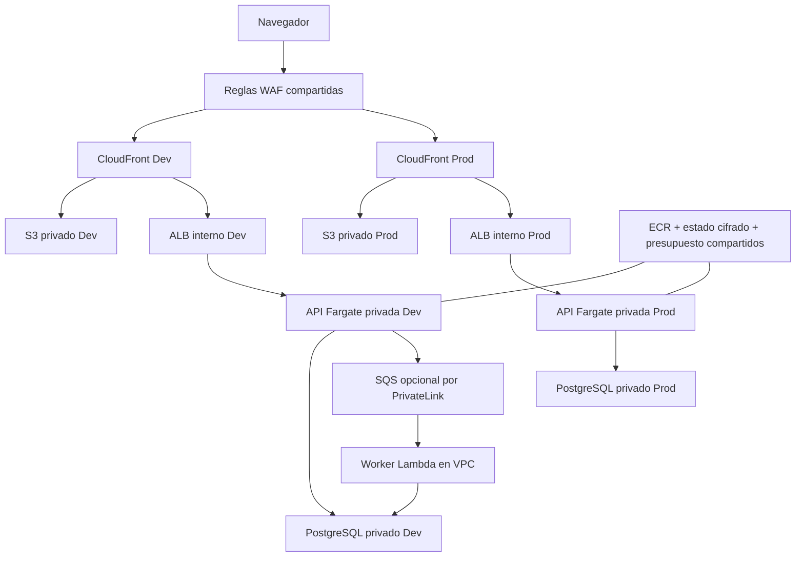

# Goliat Forge

[English](README.md) · **Español**

**Una plataforma modular de aplicaciones para AWS.** Comparte la fundación, aísla Dev y Prod y entiende la arquitectura mediante una aplicación que funciona.

Forge reúne módulos Terraform reutilizables, configuración comentada, CLI de despliegue, web bilingüe y **Luma**: frontend Next.js estático, API Node.js privada, persistencia PostgreSQL/MySQL/DocumentDB seleccionable y SQS/Lambda opcionales.

[Funcionamiento](docs/product.md) · [Arquitectura](docs/architecture.md) · [Despliegue](docs/deployment.md) · [Variables](docs/configuration.md) · [Motores, IAM y réplicas](docs/databases.md) · [Seguridad](docs/security.md) · [Autor](https://danieljsaldana.dev/)

## Arquitectura



Cada entorno posee VPC, datos, identidades, distribución y estado de cargas. No hay peering. ECR, reglas WAF globales, presupuesto y backend cifrado de Terraform se comparten en una cuenta. Esta base no configura AWS Organizations ni una landing zone multicuenta.

CloudFront llega al ALB interno mediante VPC origins y las tareas no tienen IP pública. PrivateLink conecta las APIs AWS sin salida general a Internet. Una Lambda auxiliar, invocada por IAM y sin URL pública, obtiene las claves públicas de Cognito para validar JWT y sus rotaciones. No está en la VPC ni tiene acceso a datos de negocio. El worker de negocio sí se conecta a la VPC.

**Límite de cifrado:** el navegador utiliza HTTPS; CloudFront → ALB → API usa HTTP sobre el camino privado. PostgreSQL utiliza TLS validado y autenticación IAM. No se implementa TLS extremo a extremo ni mTLS. Revisa [arquitectura y aceptación de producción](docs/architecture.md). Prod exige dominio propio y certificado ACM en us-east-1; Dev/demo admiten el hostname generado de CloudFront.

## Prueba local

```sh
npm ci
npm run setup:web
npm test
npm run demo
```

Abre **http://127.0.0.1:4080/**. Luma usa memoria, solicitudes ficticias y un operador de ejemplo, sin conectarse a AWS. Se detiene con Ctrl+C. En AWS siempre exige Cognito. La demo local es distinta del perfil Terraform demo, que sí crea recursos facturables.

## Empieza con una web

**Next.js → Node.js → datos privados** es el flujo inicial. SQS queda como extensión opcional: activa `events_enabled = true` para crear la cola, DLQ y worker. La interfaz se adapta al modo elegido. Los datos de la demo local son ficticios y viven en memoria.

## Configuración que se puede leer

| Archivo | Función |
| --- | --- |
| [environments/common.tfvars](environments/common.tfvars) | Nombre, región, etiquetas, presupuesto y logs compartidos |
| [environments/dev.tfvars](environments/dev.tfvars) | Red, capacidad, base de datos y portales Dev |
| [environments/prod.tfvars](environments/prod.tfvars) | Multi-AZ, réplicas, MFA y protección de datos Prod |
| [environments/dev.auto.tfvars.example](environments/dev.auto.tfvars.example) | Plantilla completa de override local opcional |
| [environments/prod.auto.tfvars.example](environments/prod.auto.tfvars.example) | Override de Prod |
| [examples/demo](examples/demo/README.md) | Instalación de evaluación independiente |

El mapa `portals` define las vistas `tenant` y `admin`. Otra clave reutiliza una vista bajo una ruta diferente sin añadir cinco flags. No genera una aplicación de negocio nueva. `events_enabled` controla los recursos de cola/worker de negocio; la función auxiliar de claves sigue siendo necesaria.

Las credenciales no se guardan en tfvars. RDS gestiona el secreto maestro en Secrets Manager; API y worker usan usuarios distintos con autenticación IAM y permisos limitados. El CLI genera `.auto.tfvars.json` en `.forge/`, fuera de Git. Los JSON no admiten comentarios; los ejemplos HCL sí.

## Despliegue AWS

Requiere Terraform >=1.10 y <2, Python >=3.11 en macOS/Linux, AWS CLI v2, Node.js >=24, npm y Docker con motor Linux y Buildx. Usa una sesión SSO o un rol federado; no se crean usuarios IAM ni claves permanentes.

```sh
aws sso login --profile platform
./forge configure --name myforge --region eu-west-1 --config .local/config
# Revisa y adapta primero los valores comentados.
./forge --profile platform deploy --config .local/config --environment dev --yes
```

El CLI coordina **bootstrap del estado → fundación compartida → publicación de imagen/funciones → entorno → migración privada → activación → frontend**. Cada aplicación utiliza su plan guardado. En la primera instalación la API permanece inactiva hasta completar la migración. Las siguientes ejecuciones conservan los estados y despliegan imágenes por digest.

Configura tu dominio y ACM antes de planificar Prod: no hay ningún ARN real de certificado en los ejemplos. Usa `--environment prod` al completar sus valores y pruebas de aceptación. `--environment all` coordina Dev y Prod conservando estados separados. Consulta [la guía](docs/deployment.md), incluidos IAM, cuotas y usuarios Cognito.

La base se comprueba localmente, con PostgreSQL y proveedores simulados; no se presenta como desplegada en tu cuenta AWS. Sigue siendo necesario validar servicios en tu región y hacer ejercicios de recuperación.

## Web del producto

```sh
npm run site
make site-serve
```

Abre **http://127.0.0.1:8768/**. Incluye ES/EN, diagramas interactivos de arquitectura y seguridad, código de módulos, tfvars comentados, una captura real de Luma y un laboratorio de outbox/reintentos en el navegador. Los diagramas también abren por separado. El build versiona los imports JavaScript para evitar copias antiguas del navegador.

Repositorio: https://github.com/danieljsaldana/goliat-forge. Pages utiliza `GITHUB_REPOSITORY` para enlazar el GitHub y la web reales. El contador no inventa estrellas. El workflow diario publica solo JSON; la página visible revalida al volver a la pestaña y cada minuto, sin build diaria. Sponsor es el último enlace del footer.

## Verificar y operar

```sh
./forge check
make test
make terraform-test
npm run setup:web
npm run build:web
npm run site
npm run test:site
python3 scripts/check_publication.py
```

Las pruebas Terraform usan proveedores simulados y no crean recursos AWS. La integración SQL opcional utiliza una base PostgreSQL local desechable indicada mediante `TEST_DATABASE_URL`; CI la ejecuta con PostgreSQL 17. El [catálogo de recursos](docs/resources.md) refleja declaraciones de código, no una cuenta desplegada.

[Aplicación de referencia](docs/reference.md) · [GitHub y CI](docs/workflows.md) · [Costes](docs/costs.md) · [Recuperación y destrucción](docs/operations.md) · [Contribuir](CONTRIBUTING.es.md)

RDS, ALB, endpoints y tareas generan coste aunque no haya tráfico. El presupuesto avisa, no limita el gasto. El teardown conserva datos/estado protegidos y no purga automáticamente contenido.

## Licencia

[PolyForm Noncommercial 1.0.0](LICENSE), con su [alcance](LICENSING.md). El código está disponible para los usos permitidos por esa licencia; no concede con carácter general uso comercial. Las dependencias, fuentes e iconos conservan sus licencias.

Elige `db_kind`: RDS PostgreSQL, Aurora PostgreSQL/MySQL o DocumentDB 5.0. La app y el worker opcional usan roles IAM. `db_read_replicas` configura lectores de clúster; RDS ofrece standby Multi-AZ porque su secreto maestro gestionado no admite crear réplicas PostgreSQL. La guía de datos explica configuración y límites.

Web pública: https://danieljsaldana.github.io/goliat-forge/. Usa `make site-serve` para servir la web completa, incluida la documentación. Las rutas originales `/site/index.html`, `/site/index.htm` y ambas páginas de diagramas también permiten previsualizar la arquitectura. Los SVG quedan visibles si JavaScript no carga.
