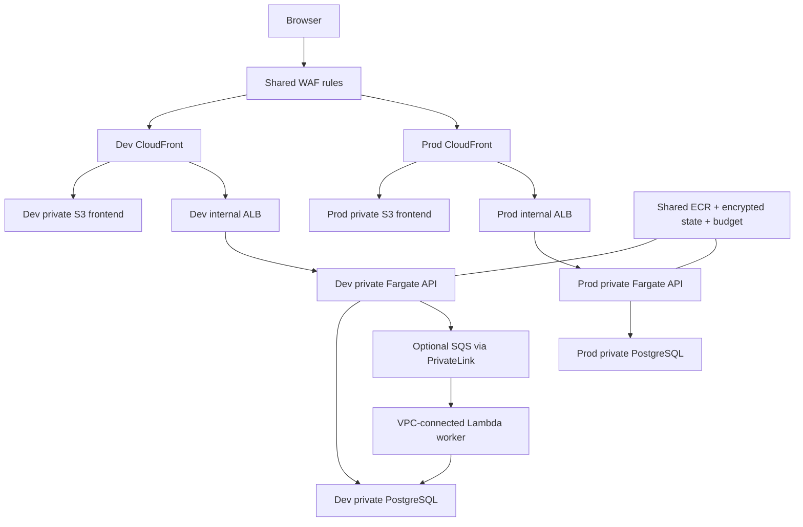

# Goliat Forge

**English** · [Español](README.es.md)

**A modular AWS reference architecture built with Terraform.** Share platform services, isolate Dev and Prod, and adapt networking, security, compute and data to your project. Luma is the included application used to exercise the architecture.

Forge combines reusable Terraform modules, commented configuration, a deployment CLI, a bilingual product website and **Luma**: a Next.js static frontend, private Node.js API, selectable PostgreSQL/MySQL/DocumentDB persistence and an optional SQS/Lambda worker.

[Product guide](docs/product.en.md) · [Architecture](docs/architecture.en.md) · [Deployment](docs/deployment.en.md) · [Configuration](docs/configuration.en.md) · [Terraform contracts](docs/terraform.en.md) · [Databases and IAM](docs/databases.en.md) · [Security](docs/security.en.md) · [Author](https://danieljsaldana.dev/)

## Architecture



Each environment has its own VPC, data, identities, edge distribution and workload state. There is no VPC peering. ECR, global WAF rules, installation budget and the encrypted state backend are shared within one account. This is not an AWS Organizations or multi-account landing-zone product.

CloudFront uses private VPC origins to reach the internal ALB; tasks have no public IP. PrivateLink supplies AWS API connectivity without general Internet egress. An IAM-invoked, non-VPC Lambda helper fetches Cognito public signing keys for JWT verification and rotation. It has no Function URL or business-data access. The business worker remains VPC-connected.

**Encryption boundary:** browsers use HTTPS; CloudFront → ALB → API uses HTTP over the private path. PostgreSQL uses validated TLS and IAM authentication. This is not end-to-end TLS or mTLS. Review [architecture and production acceptance](docs/architecture.en.md) before adapting it to a real workload. Prod requires a custom domain and ACM us-east-1 certificate; Dev/demo can use the generated CloudFront hostname.

## Try it locally

```sh
npm ci
npm run setup:web
npm test
npm run demo
```

Open **http://127.0.0.1:4080/**. The local Luma demo uses memory and fictional requests, exposes no AWS connection and stops with Ctrl+C. Both views use an explicitly marked fictional operator; production always requires Cognito. This differs from the Terraform demo profile, which creates real billable AWS infrastructure.

## Start with a web application

**Next.js → Node.js → private data** is the default. SQS is included as an optional extension: set `events_enabled = true` when you need the queue, DLQ and worker. The UI adapts to the selected mode. Local demo data is fictional and held in memory.

## Commented configuration

| File | Purpose |
| --- | --- |
| [environments/common.tfvars](environments/common.tfvars) | Shared name, region, tags, budget and logs |
| [environments/dev.tfvars](environments/dev.tfvars) | Dev networking, capacity, database and portals |
| [environments/prod.tfvars](environments/prod.tfvars) | Prod Multi-AZ, replicas, MFA and data protections |
| [environments/dev.auto.tfvars.example](environments/dev.auto.tfvars.example) | Full optional local override template |
| [environments/prod.auto.tfvars.example](environments/prod.auto.tfvars.example) | Prod override template |
| [examples/demo](examples/demo/README.md) | Separate evaluation installation |

The `portals` map provides the sample `tenant` and `admin` views. Add another key to reuse either view under another path, without adding five separate enable flags. It does not generate a new business application. `events_enabled` controls business queue/worker resources; the identity-key helper remains necessary.

Credentials never belong in tfvars. RDS manages the master secret in Secrets Manager. API and worker connect as different least-privilege IAM database users. The CLI generates runtime `.auto.tfvars.json` values in ignored `.forge/` workspaces; JSON cannot contain comments.

## Deploy to AWS

Requires Terraform >=1.10 and <2, Python >=3.11 on macOS/Linux, AWS CLI v2, Node.js >=24, npm and Docker with a Linux engine and Buildx. Use an existing SSO session or federated role; no permanent IAM user/access keys are created.

```sh
aws sso login --profile platform
./forge configure --name myforge --region eu-west-1 --config .local/config
# Read and edit the generated commented settings first.
./forge --profile platform deploy --config .local/config --environment dev --yes
```

The CLI coordinates **state bootstrap → shared foundation → image/function publication → environment → private database migration → workload activation → frontend publication**. Each Terraform apply uses its saved plan. The first deployment starts the workload inactive until migration succeeds. Subsequent runs retain installation state and use immutable ECR digests.

Prod requires your domain and ACM certificate before planning; the example intentionally contains no real certificate ARN. Use `--environment prod` after completing its settings and acceptance checks. `--environment all` coordinates separate Dev/Prod states. [Read the deployment guide](docs/deployment.en.md), including IAM, service quotas and Cognito users.

This foundation has local, PostgreSQL and mocked-provider verification; it has not been represented as deployed in your AWS account. Region-specific service acceptance and recovery exercises remain required.

## Product website

```sh
npm run site
make site-serve
```

Open **http://127.0.0.1:8768/**. The website includes ES/EN, two interactive architecture/network diagrams, module source readers, commented tfvars, a real Luma screenshot, and an in-browser outbox/replay laboratory. Its diagrams also open independently. The build hashes JavaScript imports so stale browser copies do not hide fixes.

Repository: https://github.com/danieljsaldana/goliat-forge. Pages builds derive the actual GitHub and website URLs from `GITHUB_REPOSITORY`; local builds do not invent a repository or a star count. The prepared daily stars workflow updates only public JSON. Visible pages revalidate it on tab return and every minute without a daily website build. Sponsor is the final footer link.

## Validation and operation

```sh
./forge check
make test
make terraform-test
npm run setup:web
npm run build:web
npm run site
npm run test:site
python3 scripts/check_publication.py
```

`terraform-test` uses mocked providers and never creates AWS resources. CI exercises PostgreSQL 17, MySQL 8.4 and an authenticated MongoDB replica set in disposable containers. The browser suite checks the real Next.js export and the interactive product demo. [Resource catalog](docs/resources.en.md) lists declarations rather than claiming deployed counts.

[Reference application](docs/reference.en.md) · [Wiki](https://github.com/danieljsaldana/goliat-forge/wiki) · [GitHub and CI](docs/workflows.en.md) · [Costs](docs/costs.en.md) · [Recovery and teardown](docs/operations.en.md) · [Contributing](CONTRIBUTING.md)

RDS, ALB, endpoints and running tasks can incur charges without traffic. Budgets notify rather than cap spending. Teardown is reviewed and retains protected state/data; no automatic data purge is included.

## Licence

[PolyForm Noncommercial 1.0.0](LICENSE), with [licensing scope](LICENSING.md). Source is available for the purposes permitted by that licence; commercial use is not generally granted. Third-party packages, fonts and icons retain their notices.

Choose `db_kind`: RDS PostgreSQL, Aurora PostgreSQL/MySQL or DocumentDB 5.0. The app and optional worker use IAM roles. Cluster readers are configured in `db_read_replicas`; RDS uses standby Multi-AZ because AWS-managed master secrets cannot source PostgreSQL read replicas. See the database guide for the complete configuration and compatibility limits.

Public website: https://danieljsaldana.github.io/goliat-forge/. Use `make site-serve` for a complete local build, including documentation. Raw `/site/index.html`, `/site/index.htm` and both source diagram pages also support architecture previews. Diagram SVG fallbacks remain visible without JavaScript.
